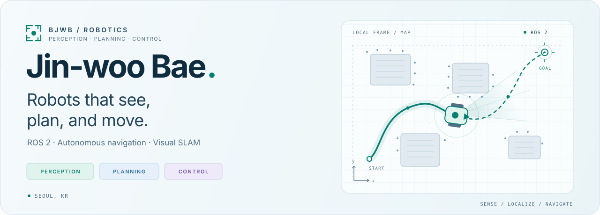

<picture>
  <source media="(prefers-color-scheme: dark)" srcset="./assets/robotics-hero-dark.svg">
  <source media="(prefers-color-scheme: light)" srcset="./assets/robotics-hero-light.svg">
  
</picture>

  <strong>로봇이 세상을 이해하고, 스스로 움직이도록.</strong>

I'm **Jin-woo Bae**, a robotics developer in Seoul working on **autonomous mobile robots**.
I connect perception and mapping with motion planning and control, mostly in the **ROS 2** ecosystem.

### What I work on

- **Perception & mapping** — RGB-D sensing, visual SLAM, and RTAB-Map.
- **Planning & navigation** — occupancy maps, Voronoi roadmaps, and Nav2.
- **Motion control** — model predictive control, obstacle constraints, and trajectory tracking.

### Featured projects

| Project | What you'll find |
| :--- | :--- |
| [**mpc_lib** ↗](https://github.com/bjwb/mpc_lib)   `Nav2` `ACADOS` `MPC` | A differential-drive MPC controller for Nav2, with sensor-based obstacle constraints and curvature-aware reference speeds. |
| [**bcr_vslam** ↗](https://github.com/bjwb/bcr_vslam)   `ROS 2` `RTAB-Map` `Gazebo` | RGB-D robot simulation, visual SLAM, and Nav2 bringup, from sensor bridges to voxel costmaps. |
| [**voronoi_diagram** ↗](https://github.com/bjwb/voronoi_diagram)   `Python` `Path planning` `RViz` | Occupancy maps turned into Voronoi roadmaps, with clearance-aware graph export and ROS 2 visualization. |

### Toolbox

**Robotics** &nbsp; `ROS 2` `Nav2` `RTAB-Map` `Gazebo` `RViz`  
**Development** &nbsp; `Python` `ACADOS` `Linux` `Git`

<strong>Also exploring</strong> · Learning from people, navigating around people

 

- **Social navigation** — following the field through [awesome-robot-social-navigation](https://github.com/bjwb/awesome-robot-social-navigation), a fork of the community reading list.
- **Inverse reinforcement learning** — exploring existing algorithm implementations in my [Inverse-Reinforcement-Learning fork](https://github.com/bjwb/Inverse-Reinforcement-Learning).

---

  From sensor data to purposeful motion.

